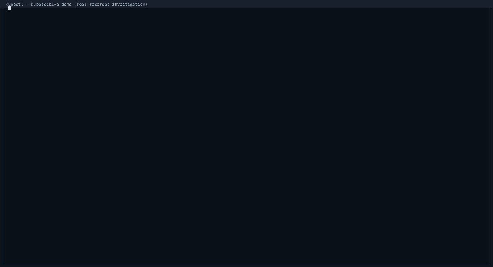

# KubeTective

[](https://github.com/GlediLami/kubetective/actions/workflows/ci.yml)
[](https://github.com/GlediLami/kubetective/releases/latest)
[](LICENSE)

KubeTective investigates Kubernetes incidents. It collects facts from the
cluster, builds a timeline, ranks possible causes and prints the evidence
behind each score. The verdict comes from rules, not from a language model, so
the same recording always gives the same result.

[Docs](https://gledilami.github.io/kubetective/) ·
[Changelog](CHANGELOG.md) ·
[Contributing](CONTRIBUTING.md)



## Example

```sh
$ kubectl investigate deployment/checkout -n prod --since=30m
╭──────────────────────────────────────────────────╮
│ INCIDENT: deployment/prod/checkout               │
│ Status: OOMKILLED                                │
│ Severity: HIGH                                   │
│ Confidence: 97%                                  │
╰──────────────────────────────────────────────────╯

ROOT CAUSE
  Configuration regression: commit 9f2c1a7d (checkout: bump CACHE_SIZE
  5000 -> 50000) preceded the failure

EVIDENCE
  ✓ commit 9f2c1a7d: checkout: bump CACHE_SIZE 5000 -> 50000 (+30)
  ✓ commit 6 min before onset (+25)
  ✓ workload observed changed in window (+10)
  ✓ mechanism: failure follows the change (+30)

RECOMMENDATION
  roll back deployment/prod/checkout to the last known-good revision [MEDIUM]
```

Kubernetes reports the symptom (`OOMKilled`). KubeTective links it to the
commit that came six minutes before. Each line under EVIDENCE adds to the
score, and the numbers in brackets show how much.

## Try it without a cluster

```sh
git clone https://github.com/GlediLami/kubetective.git && cd kubetective
make build
bin/kubetective replay scenarios/config-regression/record.jsonl
```

This replays the incident above from a recorded file. Every folder in
[`scenarios/`](scenarios/) works the same way.

## Install

```sh
brew install gledilami/kubetective/kubetective
go install github.com/GlediLami/kubetective/cmd/kubetective@latest
```

To use it as a `kubectl` plugin, put the `kubectl-investigate` binary on your
`PATH`:

```sh
make install-plugin
kubectl investigate deployment/checkout -n prod --since=30m
```

Building from source needs Go 1.26 or newer.

## Usage

```sh
kubetective investigate deployment/checkout -n prod --since=30m
kubetective investigate pod/checkout-7f84c9 -n prod
kubetective investigate namespace/prod
kubetective incidents                  # list recorded investigations
kubetective replay <incident-id>       # run one again
kubetective action <incident-id>       # preview a fix (read-only)
kubetective doctor                     # check kubeconfig, store and sources
```

Supported targets are `pod`, `deployment` and `namespace`.

More evidence sources are optional. If a source is missing, the report lists
it under EVIDENCE GAPS.

```sh
kubetective investigate deployment/checkout -n prod \
  --prometheus-url http://localhost:9090 \
  --loki-url http://localhost:3100 \
  --git-repo ~/code/manifests
```

`--git-repo` is what links a failure to a commit. Without it, the engine can
only see that the workload changed.

## What it detects

There are 11 analyzers: OOM kills, crash loops, image pull failures,
unschedulable pods, node pressure, liveness and readiness probes, PVC binding,
service selector mismatches, HPA limits, DNS failures, and configuration
regressions linked to a Git or GitOps commit.

Evidence comes from Kubernetes, Prometheus, Loki, Git, Flux and Argo CD.

KubeTective runs as a CLI, a `kubectl` plugin, a REST server (`serve`) or an MCP
server (`mcp`). Every investigation is saved as a JSONL record under
`~/.kubetective/incidents`, so it can be replayed or turned into a test case.

## How the score works

Each analyzer adds evidence terms with fixed weights. The score is their sum on
a [six-band scale](internal/score/scale.go), and every term is printed. An
optional LLM can rewrite the explanation in plainer words. It cannot change the
score, the cause or the action.

Remediation is read-only by default. `kubetective action <incident-id>` shows
the change. It runs only with `--apply <action-id> --yes`.

## Benchmark

The scenario suite runs on every commit:

```
17/25 scenarios passed (8 hard scenarios are advisory: they calibrate, they do not gate)
mutation gate: 17/17 causal claims held (the verdict changes when its evidence is removed)
noise gate:    25/25 verdicts held under 500 irrelevant observations
calibration:   24 ground-truth points (7 incorrect), accuracy 71%
```

Six scenarios were recorded from a live cluster. The engine gets five of them
wrong: a CPU limit that starves a liveness probe, a frontend blamed for its
backend, an evicted pod, a missing Secret and a blocked init container. They
stay in the suite on purpose, because a suite with only solved cases cannot
calibrate confidence.

`kubetective benchmark --adopt` writes the fitted calibration to
`~/.kubetective/config.json`. After that, displayed confidence values change
(for example 97% becomes 85% in the example above). Without `--adopt` the
config is not touched.

## Known limits

- When no analyzer matches, the engine can fall back to "Configuration
  regression: a change preceded the incident" at about 65 to 79%, with no
  commit named. A missing Secret mount is one such case. Treat that verdict as
  "unknown".
- `namespace/...` reports only the strongest problem in the namespace.
  Investigate a deployment or pod to see the others.
- `service/...` targets are not supported yet. Investigate the deployment
  instead.

## Documentation

| | |
|---|---|
| [CLI reference](docs/cli.md) | Every command and flag |
| [Configuration](docs/configuration.md) | Config file, env vars, per-context profiles |
| [API reference](docs/api.md) · [OpenAPI spec](docs/openapi.yaml) | REST and MCP servers |
| [Architecture](docs/architecture.md) | Pipeline and safety model |
| [Alert integrations](docs/alerts.md) | PagerDuty, Grafana, Slack webhooks |
| [Benchmark suite](scenarios/README.md) | What the gates measure |

## Contributing

The most useful contribution is a real incident.
`kubetective scenario new <incident-id>` sanitises a recording, replays it and
drafts a scenario for you to correct. A scenario the engine gets wrong is as
useful as one it gets right.

```sh
make build test vet fmt
bin/kubetective benchmark
```

A new analyzer implements `analyze.Analyzer`, is registered in
`internal/cli/root.go`, and comes with a scenario. See
[CONTRIBUTING.md](CONTRIBUTING.md) and [SECURITY.md](SECURITY.md).

## License

[Apache-2.0](LICENSE)
